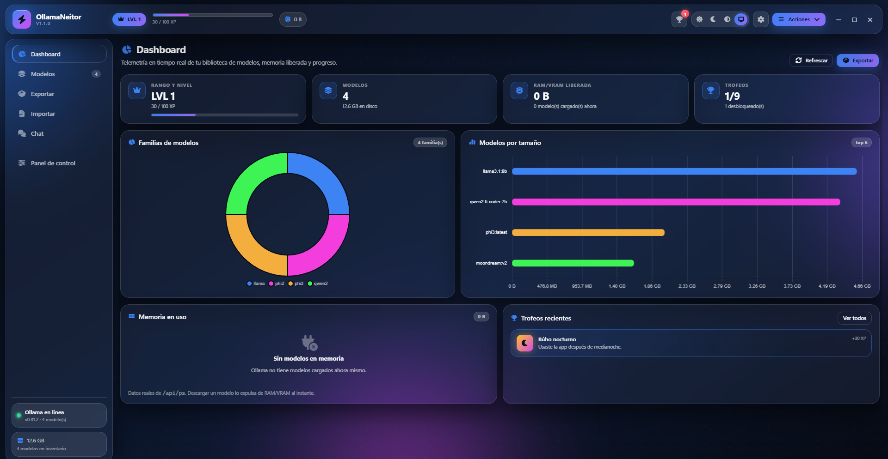

# OllamaNeitor

**Versión 1.1.0** · Gestor de modelos de Ollama con interfaz glass, 12 temas y dashboard gamificado.

Aplicación de escritorio para Windows construida con **Electron**, sin bundler en el renderer y con todas las librerías empaquetadas para funcionar sin conexión.

## Descargar

La versión **1.1.0** está disponible en [GitHub Releases](https://github.com/genioloko19/OllamaNeitor/releases):

- `OllamaNeitor-1.1.0-x64.exe` — instalador para Windows.
- `OllamaNeitor-1.1.0-portable.exe` — versión portable sin instalación (datos junto al `.exe`).

> El ejecutable no está firmado: Windows puede mostrar un aviso de SmartScreen. Usa "Más información → Ejecutar de todos modos".

[📘 Manual de usuario completo](docs/MANUAL.md) · [Arquitectura](docs/ARCHITECTURE.md) · [Canales IPC](docs/IPC.md) · [Contribuir](CONTRIBUTING.md) · [Seguridad](SECURITY.md)



---

## Funcionalidad

- **Inventario híbrido**: manifiestos en disco + API de Ollama (`/api/tags`), con búsqueda instantánea por nombre, tag, familia, parámetros, quantización y digest.
- **Exportación segura**: staging, comprobación de espacio, copia con sha256 en una pasada, verificación, `.part` + renombrado atómico, cancelación y limpieza. Los modelos solo API se bloquean y los nombres se reservan para evitar colisiones.
- **Importación atómica por modelo**: lectura del índice sin extraer, validación de tipos (sin symlinks/hardlinks), verificación de digests, `.part` + renombrado, backup en overwrite, rollback por modelo y previsualización de conflictos.
- **Cola de trabajos**: exportación, importación y descargas comparten registro, cola, historial, progreso persistente al navegar, cancelación y reenganche desde el Panel de control.
- **Mantenimiento real**: limpieza de blobs huérfanos, verificación de integridad por modelo, detección de blobs faltantes y borrado sin tocar blobs compartidos.
- **Dashboard real**: KPIs de nivel, modelos, RAM/VRAM liberada y trofeos; gráficas de familias y tamaños; widget de memoria con `GET /api/ps` y descarga de modelos con `keep_alive: 0`.
- **Chat**: streaming con `/api/chat`, historial persistente, system prompt, temperatura, top_p, num_ctx, num_predict, keep_alive, adjuntos de imagen, Markdown saneado con DOMPurify, copia de código y renombrado de conversaciones.
- **Operaciones de modelo**: copiar/renombrar, push, crear desde Modelfile, ver Modelfile, borrado masivo y descarga de memoria masiva.
- **Backup/restore**: configuración, logros y conversaciones en `.tar.gz`, con backup automático previo a cada restauración.
- **Bandeja y notificaciones**: cierre a bandeja, menú contextual y avisos nativos al terminar trabajos.
- **Autoactualización**: `electron-updater` desde GitHub Releases, con estados y control desde Ajustes.
- **Compresión**: exportación `.tar` o `.tar.gz`; importación `.tar`, `.tar.gz` y `.tgz`.
- **Reintento**: las exportaciones e importaciones fallidas se pueden reencolar desde el historial.
- **12 temas independientes** (paleta + geometría + patrón + orbes) y **3 variantes** (Claro, Oscuro, Alto contraste) + **Auto** según Windows.
- **Portable real**: los datos se guardan en `OllamaNeitorData` junto al ejecutable, con fallback a AppData si la carpeta no es escribible.
- **Gamificación**: XP, niveles, 9 trofeos, confeti y acorde Web Audio de 4 notas, con conteo real de corrupciones.
- **Accesibilidad**: alto contraste real (sin blur ni orbes), foco visible, navegación por teclado, `prefers-reduced-motion` y modo rendimiento.

## Requisitos

- Windows 10/11 (probado en Windows 11).
- Node.js 20.19 o superior.
- Ollama instalado y en ejecución para las funciones de API (el inventario local funciona sin Ollama).

## Instalación y ejecución

```bash
npm install
npm run vendor:copy   # copia Font Awesome, Chart.js, SweetAlert2, etc.
npm start             # compila temas y abre la app
```

Modo desarrollo con DevTools:

```bash
npm run dev
```

## Pruebas

```bash
npm test              # Vitest: temas, contraste, manifiestos, búsqueda, logros, tar, export, import transaccional, jobs, inventario
npm run audit:contrast
npm run verify        # temas + contraste + tests
```

## Compilación a Windows

```bash
npm run build:win     # instalador NSIS + portable en dist/
```

Sin firma de código, SmartScreen puede mostrar un aviso al ejecutar el `.exe`.

## Estructura

```
electron/            main, preload, IPC y workers de transferencia
src/core/            configuración, inventario, exportación, importación, API, logros
src/renderer/
  css/               tokens, glass, layout, componentes y temas generados
  js/                motor de temas, vistas, librerías y utilidades
  themes/            registry.js (fuente de verdad de los 12 temas)
  vendor/            librerías offline
tools/               generador de temas, auditoría de contraste, icono y vendor
tests/               pruebas unitarias
```

## Datos de la aplicación

### Versión instalada

La versión instalada guarda todo en:

```
config.json          configuración (escritura atómica + backup)
config.json.bak      copia de seguridad
achievements.json    XP, trofeos y estadísticas
conversations/       historial del chat
logs/app.log         registro rotativo
temp/                staging de importación
```

### Versión portable

Los datos se guardan en `OllamaNeitorData` junto al `.exe`. Si esa carpeta no
es escribible, la aplicación cae a `%APPDATA%\Neitor\OllamaNeitor` y lo registra
en el log.

La apariencia se guarda en `localStorage` (lectura síncrona antes del primer pintado) y se replica en `config.json`.

## Temas

`src/renderer/themes/registry.js` es la única fuente de verdad. Cada tema define:

- paleta de 4 semillas,
- geometría propia (radios, densidad, padding, blur, sombra),
- patrón de fondo y disposición de orbes,
- colores de fondo para variante clara y oscura.

El script `npm run themes:build` genera `css/themes.generated.css` (36 bloques) y `themes/themes.boot.js`, y **falla** si alguna combinación no cumple contraste (4.5:1 texto, 3:1 UI, 7:1 en alto contraste).

## Seguridad

- `contextIsolation: true`, `sandbox: true`, `nodeIntegration: false`.
- Protocolo propio `app://neitor` (origen estable para localStorage).
- CSP estricta y sin contenido remoto.
- Validación de entradas de tar: rutas absolutas, `..`, unidades, NUL, symlinks, hardlinks y entradas especiales.
- Contención de rutas con `assertInside` en exportación e importación.
- IPC con validación de payloads y respuestas `{ ok, data | error }`.

## Limitaciones conocidas de 1.1.0

- Sin firma de código ni certificado configurado. La autoactualización funciona, pero Windows puede mostrar SmartScreen.
- `asar` está desactivado para que los workers de transferencia puedan requerir `tar` desde el sistema de archivos.
- Los paquetes `.tar` y `.tar.gz` son el formato propio de OllamaNeitor (manifiestos + blobs). `.tar.zst` queda para 1.2.
- La reanudación real de una exportación/importación `.tar` no está implementada; se ofrece reintento desde el historial. Las descargas de Ollama sí se reanudan por digest.
- i18n: la base está preparada, pero la interfaz sigue mayoritariamente en español.
- Backup programado y restauración selectiva por conversación quedan para 1.2.
