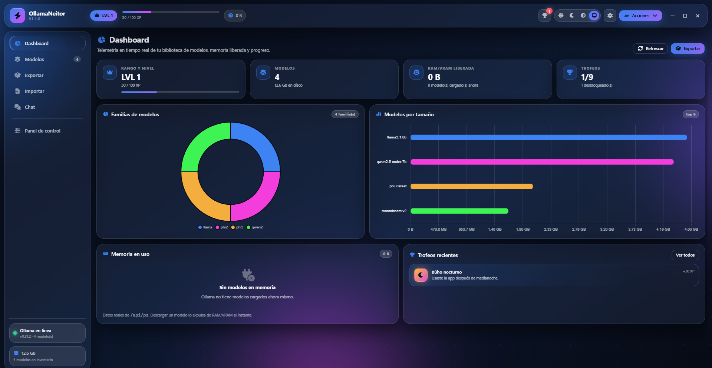
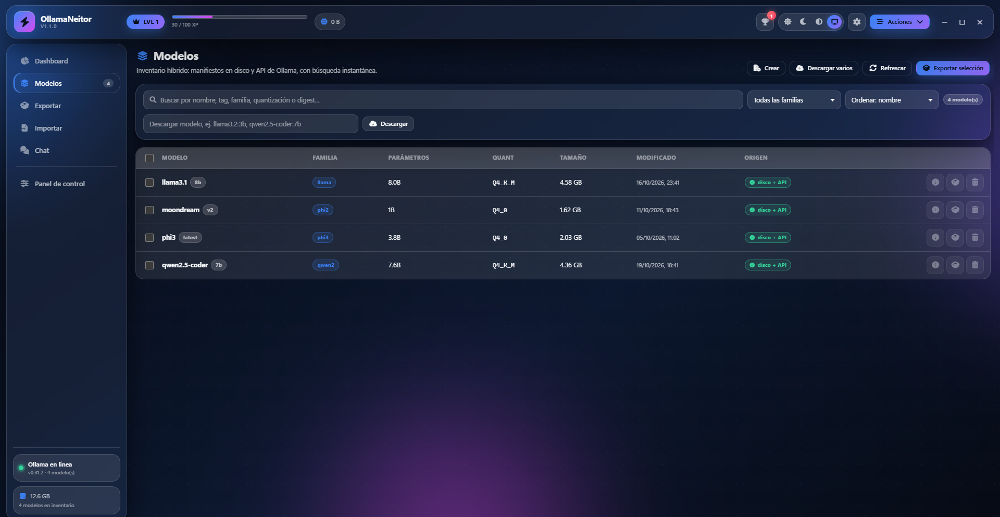
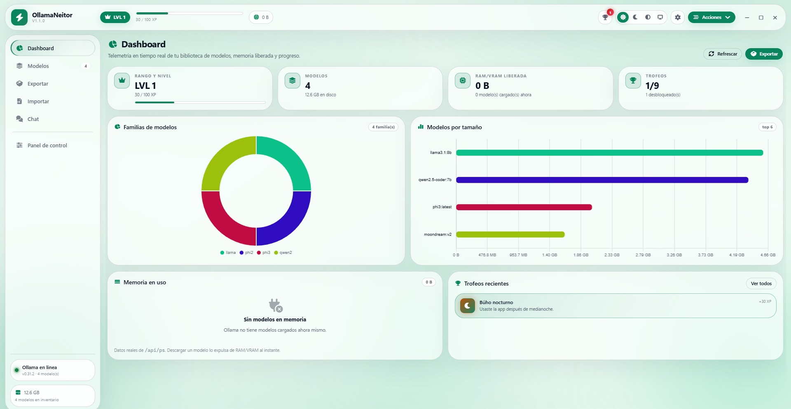
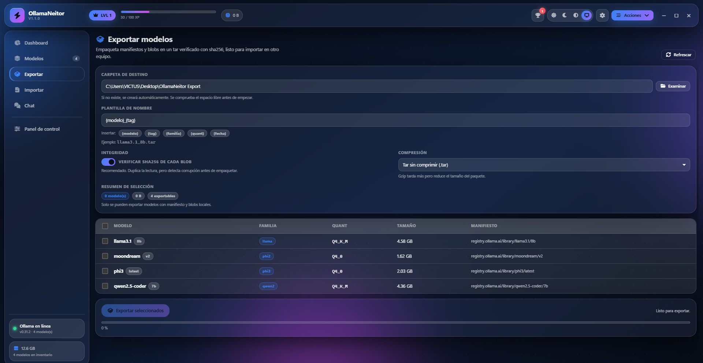
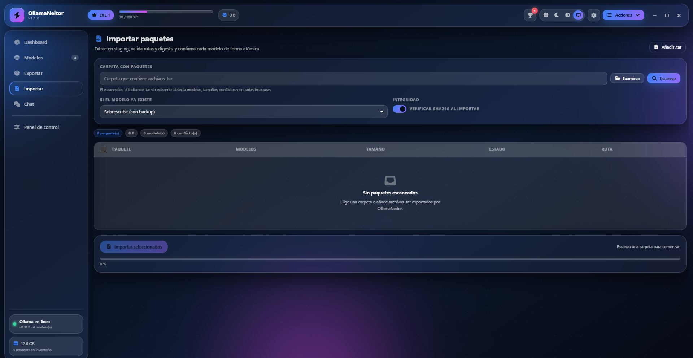
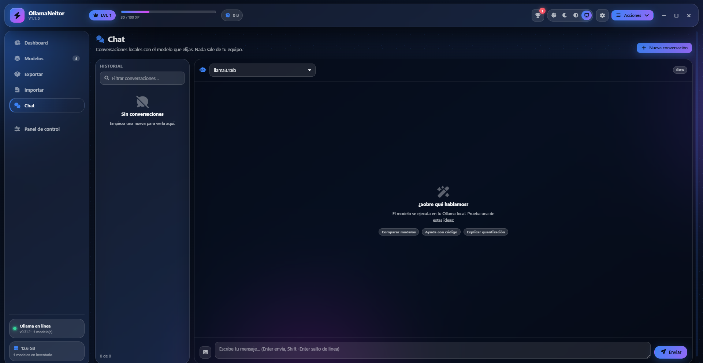
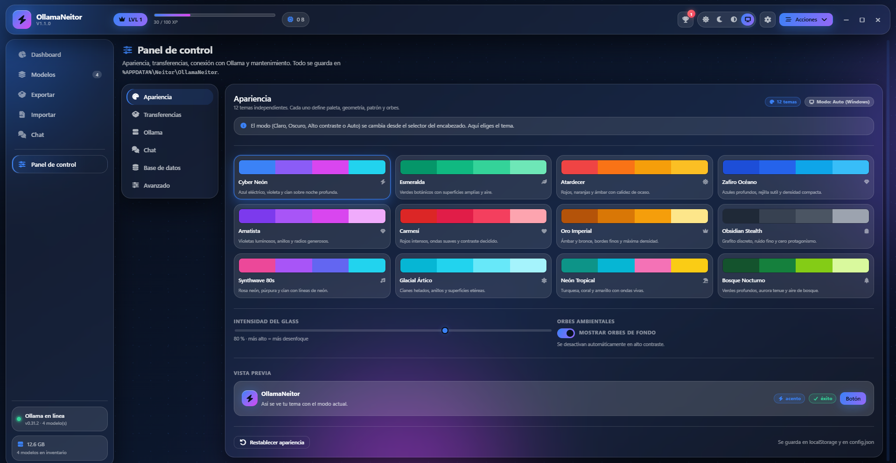
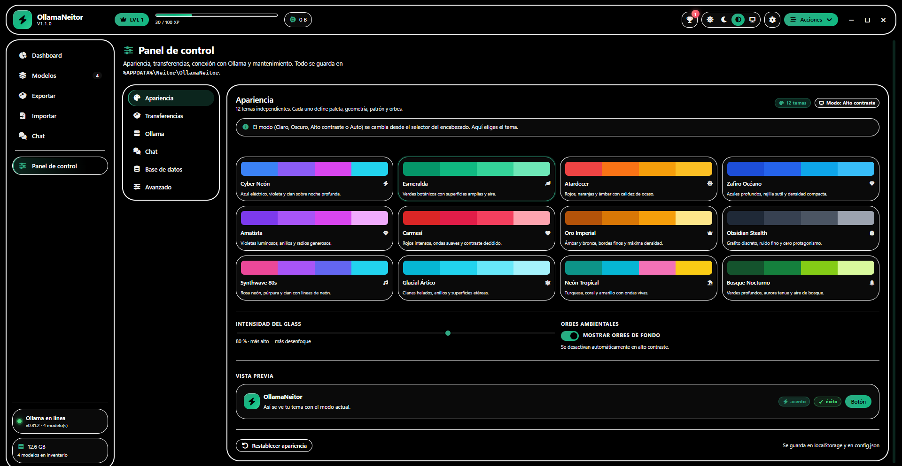
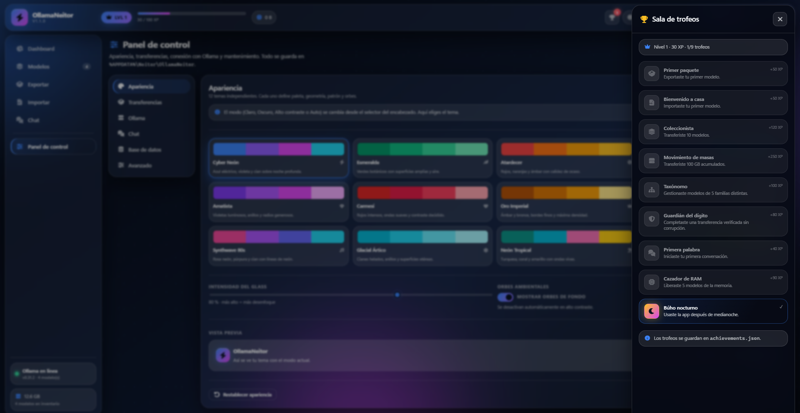

# Manual de OllamaNeitor 1.1.0

Guía completa de instalación, uso y resolución de problemas.



---

## Índice

1. [Qué es OllamaNeitor](#qué-es-ollamaneitor)
2. [Requisitos](#requisitos)
3. [Instalación](#instalación)
4. [Primer arranque](#primer-arranque)
5. [Dashboard](#dashboard)
6. [Modelos](#modelos)
7. [Exportar](#exportar)
8. [Importar](#importar)
9. [Chat](#chat)
10. [Panel de control](#panel-de-control)
11. [Temas y modos](#temas-y-modos)
12. [Trofeos y progreso](#trofeos-y-progreso)
13. [Datos y copias de seguridad](#datos-y-copias-de-seguridad)
14. [Atajos de teclado](#atajos-de-teclado)
15. [Solución de problemas](#solución-de-problemas)
16. [Desinstalación](#desinstalación)
17. [Seguridad](#seguridad)
18. [Limitaciones conocidas](#limitaciones-conocidas)

---

## Qué es OllamaNeitor

OllamaNeitor es una aplicación de escritorio para Windows que gestiona tu biblioteca de modelos de **Ollama** sin depender de la terminal.

Permite:

- Ver qué modelos tienes, su familia, parámetros, quantización y tamaño.
- Exportar modelos a un paquete `.tar` verificado con SHA-256.
- Importar paquetes en otro equipo con control de conflictos.
- Descargar modelos y liberar RAM/VRAM con un clic.
- Chatear con tus modelos locales.
- Cambiar entre 12 temas y 3 modos de accesibilidad.
- Ganar XP y trofeos mientras usas la aplicación.

Todo el procesamiento ocurre en tu equipo. La aplicación no envía modelos ni conversaciones a Internet.

---

## Requisitos

| Elemento | Requisito |
|---|---|
| Sistema | Windows 10 u 11 de 64 bits |
| Ollama | Instalado y en ejecución para descargar, chatear, borrar y consultar memoria |
| Disco | Espacio suficiente para los paquetes que exportes (se comprueba antes de empezar) |
| Desarrollo | Node.js 20 o superior |

El inventario local funciona **sin Ollama en ejecución**, leyendo directamente las carpetas `manifests` y `blobs`.

---

## Instalación

### Opción A — Instalador

1. Descarga `OllamaNeitor-1.1.0-x64.exe` desde [Releases](https://github.com/genioloko19/OllamaNeitor/releases).
2. Ejecuta el instalador.
3. Elige la carpeta de instalación y confirma.
4. Abre OllamaNeitor desde el menú Inicio o el acceso directo del escritorio.

### Opción B — Portable

1. Descarga `OllamaNeitor-1.1.0-portable.exe`.
2. Colócalo en la carpeta que quieras.
3. Ejecútalo directamente, sin instalación.

> El portable guarda sus datos en `OllamaNeitorData` junto al `.exe`. Si la carpeta no es escribible, cae a `%APPDATA%` y lo registra en el log.

### SmartScreen

El ejecutable no está firmado. Si Windows muestra "Windows protegió tu PC":

1. Pulsa **Más información**.
2. Pulsa **Ejecutar de todos modos**.

### Verificar la descarga

Descarga `SHA256SUMS.txt` del mismo release y compara:

```powershell
Get-FileHash .\OllamaNeitor-1.1.0-x64.exe -Algorithm SHA256
```

El resultado debe coincidir con la línea correspondiente de `SHA256SUMS.txt`.

---

## Primer arranque



1. Abre la aplicación.
2. Si Ollama está en ejecución, el indicador de la esquina inferior izquierda se pondrá verde y mostrará la versión.
3. La aplicación detecta por defecto `%USERPROFILE%\.ollama\models`.
4. Si tus modelos están en otra ruta, abre **Panel de control → Ollama**, selecciona la carpeta y pulsa **Guardar conexión**.

La estructura de la ruta debe contener:

```
models/
├─ blobs/
└─ manifests/
```

Si falta alguna carpeta, la aplicación lo indicará y el inventario local aparecerá vacío.

---

## Dashboard



El dashboard muestra telemetría real:

- **Rango y nivel**: XP acumulado y progreso al siguiente nivel.
- **Modelos**: número de modelos detectados y tamaño en disco.
- **RAM/VRAM liberada**: memoria que has recuperado al descargar modelos de memoria.
- **Trofeos**: desbloqueados sobre el total.
- **Familias**: gráfico de anillo con la distribución por familia.
- **Modelos por tamaño**: barras horizontales con los modelos más grandes.
- **Memoria en uso**: modelos cargados ahora mismo en Ollama, con su tamaño en RAM/VRAM y botón **Descargar**.
- **Trofeos recientes**: últimos logros desbloqueados.

El widget de memoria consulta `GET /api/ps` cada 5 segundos. Descargar un modelo usa `keep_alive: 0`, por lo que la memoria se libera de inmediato.

---

## Modelos

La tabla de modelos permite:

- **Buscar** por nombre, tag, familia, parámetros, quantización o digest.
- **Filtrar** por familia.
- **Ordenar** por nombre, tamaño, fecha o familia.
- **Descargar** un modelo escribiendo su nombre, por ejemplo `qwen2.5-coder:7b`.
- **Ver detalles** con el botón de información.
- **Exportar** un modelo concreto.
- **Eliminar** el modelo y sus blobs no compartidos.

La columna **Origen** indica:

| Valor | Significado |
|---|---|
| disco + API | Detectado en la ruta local y en Ollama |
| disco | Solo hay manifiesto local (Ollama apagado o modelo no cargado en la API) |
| API | Solo lo reporta Ollama; no se encontró el manifiesto local |

Los modelos con blobs faltantes muestran una advertencia roja.

### Operaciones de modelo

En la barra superior puedes **Crear** un modelo desde un Modelfile y **Descargar varios** modelos. Desde los detalles de un modelo puedes:

- **Copiar / renombrar** con `ollama copy`.
- **Push** al registro configurado en Ollama.
- **Ver Modelfile**.
- **Verificar integridad** con SHA-256.

La selección múltiple permite **Exportar**, **Eliminar** y **Descargar de RAM** varios modelos. El borrado y las descargas se ejecutan como trabajos con historial.

### Selección múltiple

Marca las casillas de la primera columna. La barra inferior aparece con:

- Número de modelos seleccionados.
- Botón **Limpiar**.
- Botón **Exportar**.

La selección se comparte con la vista Exportar.

---

## Exportar



1. Selecciona uno o varios modelos en **Modelos** o directamente en la tabla de Exportar.
2. Elige la **carpeta de destino**.
3. Ajusta la **plantilla de nombre**.
4. Activa o desactiva la verificación SHA-256.
5. Pulsa **Exportar seleccionados**.

### Plantilla de nombre

| Token | Sustitución |
|---|---|
| `{modelo}` | Nombre del modelo |
| `{tag}` | Tag del modelo |
| `{familia}` | Familia (llama, qwen2, phi3…) |
| `{quant}` | Quantización (Q4_K_M, Q8_0…) |
| `{fecha}` | Fecha y hora de exportación |

Ejemplo: `{modelo}_{tag}_{quant}` → `qwen2.5-coder_7b_Q4_K_M.tar`.

El formato `{fecha}` de la previsualización y del archivo final usa la misma marca temporal.

### Qué contiene el paquete

```
paquete.tar / paquete.tar.gz
├─ manifests/registry.ollama.ai/library/<modelo>/<tag>
├─ blobs/sha256-...
└─ neitor.json
```

`neitor.json` guarda metadatos de la exportación: versión, fecha, modelo y digests.

### Compresión

En **Compresión** puedes elegir:

- `.tar` — más rápido, sin compresión.
- `.tar.gz` — más lento, pero reduce el tamaño del paquete.

La importación acepta `.tar`, `.tar.gz` y `.tgz`.

### Verificación

Con la verificación activada, cada blob se copia y se hashea en una sola pasada. Si el SHA-256 no coincide con el manifiesto, la exportación de ese modelo falla y no se genera un tar corrupto.

### Espacio libre

Antes de empezar se comprueba que haya espacio suficiente (tamaño de los modelos + 8 % + 100 MB de margen). Si no lo hay, la operación se cancela con un mensaje claro.

---

## Importar



1. Abre **Importar**.
2. Selecciona la carpeta que contiene los `.tar` y pulsa **Escanear**, o usa **Añadir .tar** para elegir archivos concretos.
3. Revisa la lista: la aplicación lee los manifiestos y muestra modelos, tamaño y validez.
4. Elige la política de conflicto:
   - **Sobrescribir**: reemplaza el modelo existente.
   - **Importar con otro tag**: crea `tag-imported`, `tag-imported-2`, etc.
   - **Omitir**: conserva el modelo existente.
5. Activa o desactiva la verificación SHA-256.
6. Pulsa **Importar seleccionados**.

Los paquetes con rutas absolutas, `..`, unidades `C:`, enlaces simbólicos, hardlinks o entradas ajenas a `manifests/`, `blobs/` y `neitor.json` se marcan como inválidos y no se procesan.

La importación es **atómica por modelo**: cada manifiesto se copia primero a `.part-<uuid>`, se verifica y se renombra. Si un modelo falla, solo se revierte ese modelo; los ya confirmados permanecen. En sobrescritura se guarda un backup temporal del manifiesto anterior y se restaura si algo falla.

Acepta paquetes `.tar`, `.tar.gz` y `.tgz`. Si una importación falla, puedes reencolarla desde **Panel de control → Transferencias → Cola e historial → Reintentar**.

---

## Chat



1. Elige un modelo instalado en el selector superior.
2. Escribe tu mensaje y pulsa **Enviar**.
3. La respuesta se muestra en streaming.
4. Puedes detener la generación con **Detener**.
5. Las conversaciones se guardan automáticamente en `conversations/`.

Funciones disponibles:

- Nueva conversación.
- Filtrar conversaciones por título o modelo.
- Eliminar conversación.
- Renombrar conversación.
- Adjuntar hasta 4 imágenes por mensaje (modelos multimodales).
- System prompt y parámetros de generación persistentes.
- Botón de copiar en bloques de código.
- Markdown saneado con DOMPurify.
- Sugerencias iniciales.

El chat usa `POST /api/chat` con `temperature`, `num_ctx` y `top_p` de la configuración.

---

## Panel de control



### Apariencia

- 12 temas independientes.
- 3 modos: Claro, Oscuro y Alto contraste.
- Modo Auto que sigue el tema de Windows.
- Intensidad del glass (40–100 %).
- Interruptor de orbes ambientales.
- Vista previa en vivo.

El modo se cambia desde el **encabezado**; el tema se elige en esta pestaña.

### Transferencias

- Carpeta de destino por defecto.
- Plantilla de nombre.
- Límite de tamaño.
- Verificación SHA-256 por defecto.

### Ollama

- Host de Ollama.
- Ruta base de modelos.
- Timeout de conexión.
- Probar conexión.
- Abrir carpeta de modelos.
- Acrílico nativo de Windows 11 (opcional).
- Modo rendimiento (reduce animaciones y orbes).

### Base de datos

- Tamaño total de blobs.
- Blobs referenciados.
- Blobs huérfanos y espacio recuperable.
- Manifiestos analizados.
- Lista de huérfanos.

En la versión 1.0 la limpieza de huérfanos es destructiva y está protegida por confirmación: solo borra blobs que ningún manifiesto referencia.

### Avanzado

- Registro en vivo.
- Abrir carpeta de logs.
- **Backup y restauración**: crea un `.tar.gz` con configuración, logros y conversaciones; restaura con backup automático previo.
- **Actualizaciones**: buscar, descargar e instalar desde GitHub Releases.
- Reiniciar logros.
- Restaurar configuración.
- Abrir `config.json`.
- Abrir carpeta de datos.
- Nivel de registro.

---

## Temas y modos

### Modos

| Modo | Uso |
|---|---|
| Claro | Fondo claro, texto oscuro |
| Oscuro | Fondo oscuro, acentos luminosos |
| Alto contraste | Sin blur, sin orbes, bordes blancos de 2 px y texto a 7:1 |
| Auto | Sigue el tema de Windows en tiempo real |

El modo Auto reacciona al cambiar el tema del sistema sin reiniciar la aplicación.

### Temas

| # | Tema | Estilo |
|---|---|---|
| 1 | Cyber Neón | Azul, violeta y cian |
| 2 | Esmeralda | Verdes botánicos |
| 3 | Atardecer | Rojos y ámbar |
| 4 | Zafiro Océano | Azules compactos |
| 5 | Amatista | Violetas amplios |
| 6 | Carmesí | Rojos intensos |
| 7 | Oro Imperial | Ámbar y bronce |
| 8 | Obsidian Stealth | Grafito discreto |
| 9 | Synthwave 80s | Rosa y cian neón |
| 10 | Glacial Ártico | Cianes helados |
| 11 | Neón Tropical | Turquesa y coral |
| 12 | Bosque Nocturno | Verdes profundos |

Cada tema define su propia paleta, radios, densidad, patrón de fondo y disposición de orbes.



---

## Trofeos y progreso



| Trofeo | Cómo se desbloquea |
|---|---|
| Primer paquete | Exportar un modelo |
| Bienvenido a casa | Importar un modelo |
| Coleccionista | Transferir 10 modelos |
| Movimiento de masas | Transferir 100 GB acumulados |
| Taxónomo | Gestionar 5 familias distintas |
| Guardián del dígito | Completar una transferencia verificada sin corrupción |
| Primera palabra | Enviar el primer mensaje de chat |
| Cazador de RAM | Liberar 5 modelos de memoria |
| Búho nocturno | Usar la app entre medianoche y las 05:00 |

El XP se guarda en `achievements.json`. Puedes reiniciarlo desde **Panel de control → Avanzado**.

---

## Datos y copias de seguridad

La versión instalada guarda todo en:

```
%APPDATA%\Neitor\OllamaNeitor\
├─ config.json
├─ config.json.bak
├─ achievements.json
├─ conversations\
├─ logs\
└─ temp\
```

La versión portable guarda lo mismo en `OllamaNeitorData\` junto al ejecutable.
Si esa carpeta no es escribible, usa `%APPDATA%\Neitor\OllamaNeitor` y lo registra
en el log.

| Archivo | Contenido |
|---|---|
| `config.json` | Conexión, rutas, apariencia, chat y ventana |
| `achievements.json` | XP, trofeos y estadísticas |
| `conversations\` | Historial del chat |
| `logs\` | Registro rotativo (`app.log`) |
| `temp\` | Staging temporal de importación |

### Copia de seguridad manual

Cierra la aplicación y copia la carpeta completa:

```powershell
Copy-Item "$env:APPDATA\Neitor\OllamaNeitor" "$env:USERPROFILE\Desktop\NeitorBackup" -Recurse
```

Para restaurar, cierra la aplicación y reemplaza la carpeta.

Los modelos **no** están en esta carpeta: viven en la ruta de Ollama (`%USERPROFILE%\.ollama\models`).

---

## Atajos de teclado

| Atajo | Acción |
|---|---|
| `Ctrl + 1` | Dashboard |
| `Ctrl + 2` | Modelos |
| `Ctrl + 3` | Exportar |
| `Ctrl + 4` | Importar |
| `Ctrl + 5` | Chat |
| `Ctrl + 6` | Panel de control |
| `Ctrl + F` | Buscar modelos |
| `Esc` | Cerrar menú, cajón o modal |
| `F12` | DevTools (solo modo desarrollo) |

---

## Solución de problemas

### Ollama aparece "sin conexión"

1. Comprueba que Ollama esté en ejecución:
   ```powershell
   ollama --version
   ollama list
   ```
2. Revisa el host en **Panel de control → Ollama**. Por defecto es `http://127.0.0.1:11434`.
3. Pulsa **Probar conexión**.
4. Si usas un puerto distinto, cámbialo y guarda.

### No aparecen modelos

- Verifica que la ruta base tenga `blobs` y `manifests`.
- Pulsa **Refrescar** en Modelos.
- Si Ollama está apagado, solo se muestran los modelos con manifiesto local.

### "Estructura no verificada"

La carpeta seleccionada no contiene `manifests` o `blobs`. Selecciona la carpeta que contiene ambas, normalmente `C:\Users\<usuario>\.ollama\models`.

### "No hay espacio suficiente"

La app comprueba el espacio antes de exportar. Libera espacio o elige otra unidad.

### "La verificación de integridad ha fallado"

Un blob no coincide con el digest del manifiesto. El modelo está corrupto o el paquete se modificó. Vuelve a descargar el modelo con `ollama pull <modelo>`.

### La importación falla

- Comprueba que el `.tar` se generó con OllamaNeitor.
- Revisa que no tenga entradas inseguras.
- Prueba con **Omitir** o **Importar con otro tag** si el modelo ya existe.

### SmartScreen bloquea el ejecutable

Es normal en binarios sin firma. Usa **Más información → Ejecutar de todos modos**.

### La ventana se ve lenta

Activa **Panel de control → Ollama → Modo rendimiento**. Reduce animaciones, orbes y blur.

### El tema claro se ve poco legible

Usa **Alto contraste** desde el encabezado. Desactiva el glass al 40 % si tu monitor es brillante.

### El chat no responde

- Comprueba que el modelo esté descargado.
- Revisa la RAM disponible: un modelo grande puede tardar en cargar.
- Pulsa **Detener** y vuelve a intentar.
- Consulta el registro en **Avanzado**.

### Dónde están los logs

`%APPDATA%\Neitor\OllamaNeitor\logs\app.log`

También puedes abrirlos desde **Panel de control → Avanzado → Abrir carpeta**.

---

## Desinstalación

### Instalador

1. Configuración → Aplicaciones → OllamaNeitor → Desinstalar.
2. Borra `%APPDATA%\Neitor\OllamaNeitor` si quieres eliminar también configuración, logros y chat.

### Portable

1. Borra el `.exe`.
2. Borra `%APPDATA%\Neitor\OllamaNeitor` si quieres eliminar los datos.

Los modelos de Ollama no se borran al desinstalar OllamaNeitor.

---

## Seguridad

- `contextIsolation: true`, `sandbox: true`, `nodeIntegration: false`.
- Protocolo propio `app://neitor` con CSP estricta.
- Sin contenido remoto ni telemetría.
- Validación de entradas de tar y rutas.
- Diálogos del sistema para seleccionar carpetas.
- Los paquetes se verifican con SHA-256.

Para reportar una vulnerabilidad, abre un issue privado o contacta al mantenedor del repositorio.

---

## Limitaciones conocidas

- Sin certificado de firma configurado; la autoactualización funciona, pero SmartScreen puede avisar.
- El acrílico nativo depende de Windows 11 y del driver; si falla, se usa el glass CSS.
- El formato `.tar`/`.tar.gz` es propio de OllamaNeitor (manifiestos + blobs). `.tar.zst` queda para 1.2.
- `asar` está desactivado para que los workers carguen `tar` desde disco.
- La reanudación real de transferencias `.tar` queda para 1.2; se ofrece reintento. Las descargas de Ollama sí se reanudan por digest.
- La interfaz sigue mayoritariamente en español; la base de i18n está preparada.
- Backup programado y restauración selectiva por conversación quedan para 1.2.

---

## Soporte

- Repositorio: https://github.com/genioloko19/OllamaNeitor
- Issues: https://github.com/genioloko19/OllamaNeitor/issues
- Releases: https://github.com/genioloko19/OllamaNeitor/releases
